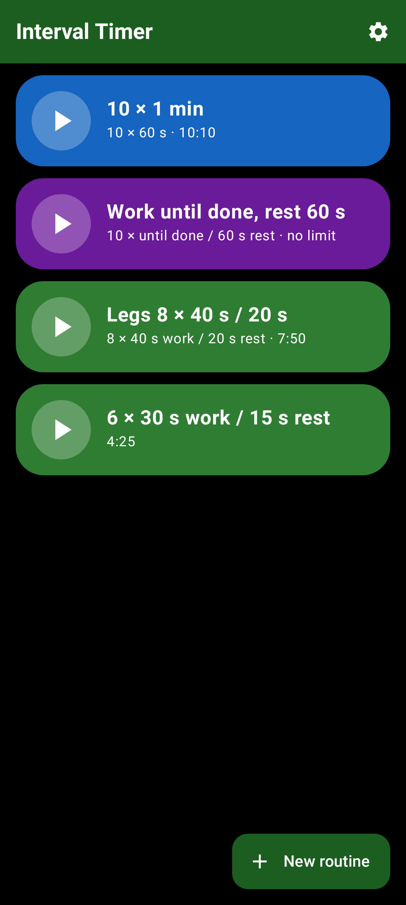
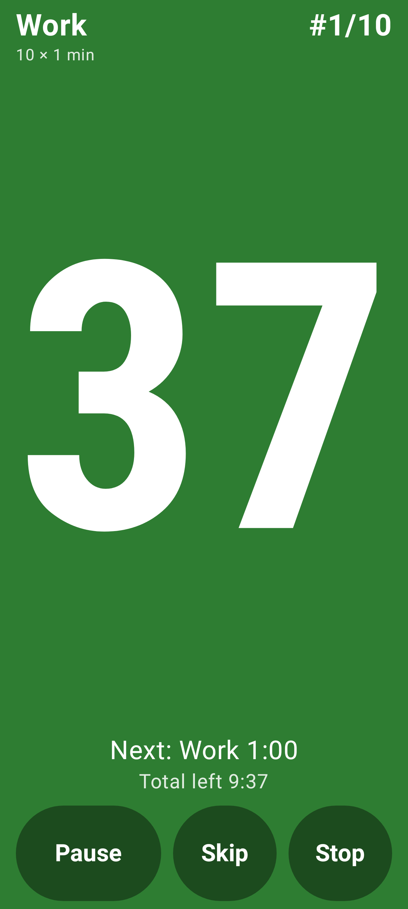
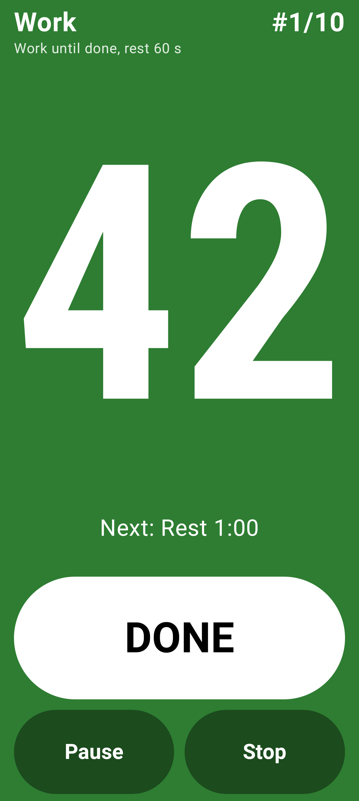

# Interval Timer

A personal, ad-free interval timer for Android, built for the gym: one tap starts a saved routine, and the whole screen changes colour with the phase so you can read it from across the room.

<p>
  
  
  
</p>

## Features

- **Saved routines, one tap to start.** Repeats of work and rest (e.g. 10 × 1 min), a plain timer, or blocks with several phases, warm-up and cool-down.
- **Work until done.** When you don't know how long a set takes, the timer counts up, you press **Done**, and a fixed rest counts down before the next set.
- **Readable from a distance.** Huge digits, the full screen in the phase colour, the next phase and total time left, big pause / skip / stop buttons.
- **Its own volume.** A timer volume slider separate from media volume, optional ducking of your music while a cue plays, spoken phase names, a 3-2-1 countdown.
- **Sound, sound and vibration, or vibration only.**
- **Survives screen-off.** Runs as a foreground service with a notification (pause, resume, skip) and keeps the screen on while running, if you want.
- **No confirmation dialogs.** Stop and delete happen at once, with a 3-second undo.
- **No ads, no accounts, no network.**

## Install

The app is not on the Play Store and has no published release yet: build it from source (below) and install it on a connected phone with `./gradlew installDebug`.

Requires Android 15 or newer (minSdk 35); developed and used on a Pixel with Android 17.

## Tech stack

- **Kotlin 2.4**, **Jetpack Compose** (BOM 2026.09) with **Material 3 Expressive** (1.5.0-alpha29)
- Android Gradle Plugin 9.4 on Gradle 9.6, JDK 25; minSdk 35, targetSdk 37
- kotlinx.serialization and DataStore for storage, coroutines and `StateFlow` for state
- JUnit 4 for the unit tests; Robolectric and Roborazzi render every screen to PNG on the JVM
- GitHub Actions: tests and a debug build on every push, and a signed release APK for every tag

## Build

You need JDK 25 and the Android SDK.

```
./gradlew assembleDebug testDebugUnitTest   # build and run the unit tests
./gradlew installDebug                      # install on a connected device
./gradlew recordRoborazziDebug              # render every screen to app/build/screens/*.png
```

On Windows use `./gradlew.bat`.

## Design notes

- **Time is computed, never counted.** The engine (`engine`, pure Kotlin with no `android.*` and no
  threads) derives the current phase and the time left from elapsed monotonic time and the routine,
  never by counting ticks. Pause, resume, skip and late ticks therefore stay exact. The clock is
  injected, so the tests use a fake clock instead of a mocking library.
- **One snapshot from the service to the UI.** A foreground service (`service`) runs the routine so
  it survives screen-off, and publishes the engine state as one immutable `StateFlow` snapshot. The
  Compose screens (`ui`) are stateless: state in, events out.
- **Undo instead of confirmation dialogs.** Stop and delete act at once, and a 3-second snackbar
  offers undo. A stop pauses the engine for those 3 seconds, so undoing resumes on the same second.
- **Storage is one JSON document.** Routines are small nested documents, so they are stored as JSON
  in DataStore rather than in a Room database. New fields carry defaults, so routines saved by older
  versions still load (`data`).
- **Screens are checked without a phone.** Robolectric and Roborazzi render every screen on the JVM,
  so layout and colour can be checked in the build. The phone is only for what no test can assert:
  sound, vibration and screen-off behaviour.

The working constraints are in [`CLAUDE.md`](CLAUDE.md), and open items with the on-phone checklist are in [`TODO.md`](TODO.md).

## Releases

Pushing a tag such as `v1.0.0` runs the tests, builds a signed APK and publishes it as a GitHub Release (see `.github/workflows/release.yml`).

## Why and how it is built

I built it for my own gym sessions because I couldn't find a convenient ad-free interval timer.
It is also how I learn agentic coding: [Claude Code](https://claude.com/claude-code) writes the
code and commits every change, so every commit is co-authored with it. I steer it and review its
design decisions, aiming for clean code and a clean architecture.

## Licence

[Apache License 2.0](LICENSE).
